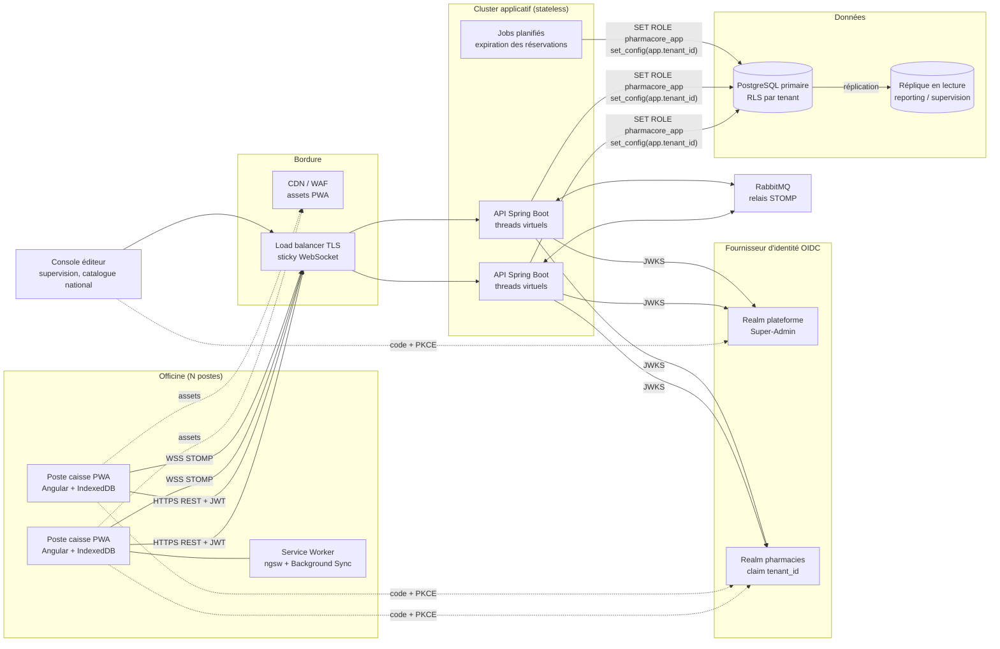
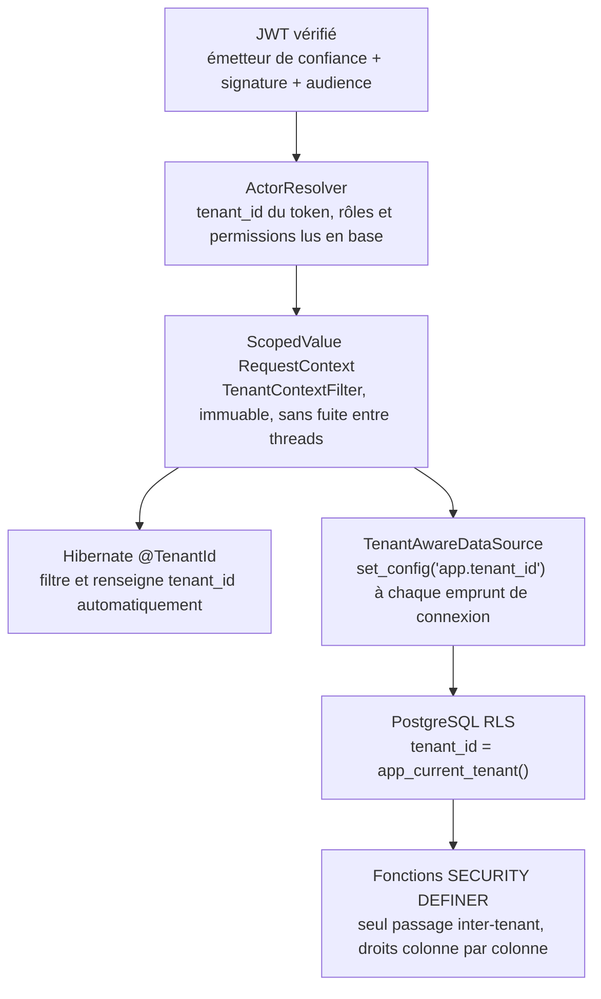
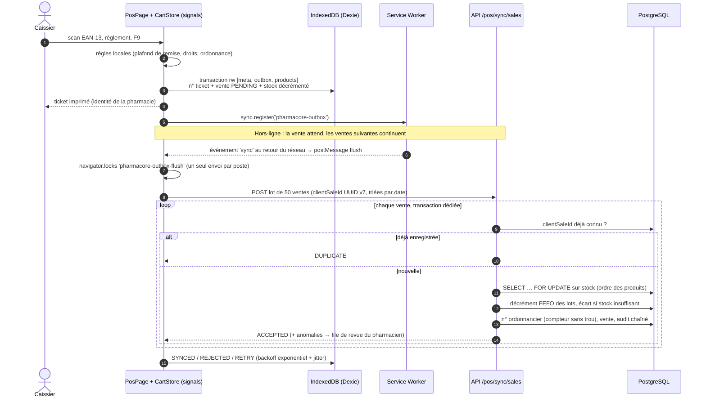
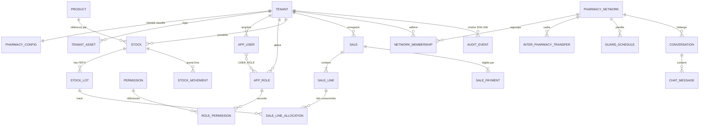

# PharmaCore PGO — Architecture technique

Progiciel de Gestion d'Officine multi-pharmacies : caisse résiliente hors-ligne, stocks FEFO,
réseau inter-officines (disponibilité, réservations, gardes, messagerie) et console éditeur.

| Couche | Choix |
|---|---|
| Backend | Java 26, Spring Boot 4.1.1 (MVC + threads virtuels), Spring Security 7 (OAuth2 Resource Server), Hibernate 7, Flyway |
| Temps réel | WebSocket STOMP (broker simple en local, relais RabbitMQ/Artemis en production) |
| Base | PostgreSQL 17 : colonne `tenant_id` + Row-Level Security |
| Frontend | Angular 22 (standalone, signals, control flow, zoneless), Tailwind CSS 4, PWA (`ngsw` + Background Sync) |
| Hors-ligne | IndexedDB via Dexie 4, journal de ventes local (outbox), synchronisation idempotente |

---

## 1. Architecture réseau et multi-tenant



### 1.1 Stratégie retenue : colonne discriminante + Row-Level Security

| Critère | Schéma par tenant | **`tenant_id` + RLS (retenu)** |
|---|---|---|
| Nombre de pharmacies | Quelques centaines au plus (catalogue, migrations × N) | Des milliers sans surcoût |
| Migrations Flyway | N exécutions, risque de dérive | Une seule |
| Requêtes inter-pharmacies (réseau, gardes, supervision) | `UNION` dynamiques entre schémas | Fonctions `SECURITY DEFINER` ciblées |
| Isolation | Forte (search_path) | Forte : politique SGBD appliquée même au SQL natif |
| Pool de connexions | Un par schéma ou `SET search_path` | Un seul pool partagé |

Une grande enseigne qui exige une isolation physique peut recevoir une base dédiée : le code est
identique, seule l'URL de connexion change.

### 1.2 Défense en profondeur



* Le tenant n'est **jamais** lu dans un en-tête ou un paramètre : il vient du token (`tenant_id`).
* Le pool exécute `SET ROLE pharmacore_app` (`connection-init-sql`) : même un compte de connexion
  privilégié par erreur reste soumis à la RLS. Flyway utilise un compte propriétaire distinct.
* Sans contexte lié, la session ne voit aucune ligne métier (*fail closed*) ; Hibernate reçoit un
  identifiant qui ne correspond à aucun tenant.
* Les opérations de plateforme (`Actor.PlatformOperator`) et les jobs transverses
  (`Actor.SystemProcess.crossTenant`) positionnent `app.platform_admin = on`.
* Le rôle `pharmacore_network_reader` (NOLOGIN) possède les fonctions du réseau ; il n'a de droits
  que sur les colonnes non sensibles (ni prix, ni coûts, ni ventes, ni lots).

Le test `TenantIsolationIT` exécute un `SELECT count(*) FROM stock_lot` brut, sans clause `WHERE`,
dans le contexte d'une autre pharmacie : le résultat est 0.

### 1.3 Synchronisation hors-ligne / en ligne de la caisse

Principe : **local-first**. La vente est définitive dès son écriture atomique dans IndexedDB, que le
réseau soit disponible ou non. Le serveur rejoue ensuite le journal de façon idempotente.



Règles clés :

| Situation | Comportement |
|---|---|
| Réponse perdue, renvoi du lot | `UNIQUE (tenant_id, client_sale_id)` → `DUPLICATE`, aucun double décrément |
| Deux onglets ou poste + service worker | Web Locks API : un seul flusher |
| Stock serveur insuffisant (vente hors-ligne) | La vente est conservée, l'écart est inscrit dans `stock.shortfall_quantity`, anomalie `STOCK_SHORTFALL` |
| Remise ou prix hors règles, ordonnance absente (hors-ligne) | Vente acceptée, `review_required = true`, file `/sales/review-queue` |
| Même violation en ligne (`POST /sales`) | Refus `422` avant toute écriture |
| Erreur transitoire (verrou, sérialisation) | `RETRY`, la vente reste en `PENDING` sur le poste |
| Catalogue et prix | Pull incrémental `/pos/catalog?since&after` (pagination par clé, curseur dans IndexedDB) |
| Supervision | Heartbeat du poste (version, ventes en attente, dernière synchro) affiché au Super-Admin |

---

## 2. Modèle de données



| Entité demandée | Classe | Remarques |
|---|---|---|
| `Tenant` | `tenant/persistence/TenantEntity` | statut, abonnement, devise, fuseau ; écriture plateforme uniquement (RLS) |
| `PharmacyConfig` | `tenant/persistence/PharmacyConfigEntity` | nom, adresse, SIRET, FINESS, préfixe ordonnancier, couleurs, en-tête et pied de ticket, logo |
| `User` | `identity/persistence/AppUserEntity` | relié à l'IdP par `external_subject` (`sub`) |
| `Role` | `identity/persistence/RoleEntity` | personnalisable par pharmacie, attribut ABAC `max_discount_percent` |
| `Permission` | `identity/domain/Permission` + table `permission` | 23 permissions fines, cohérence vérifiée au démarrage |
| `Product` | `catalog/persistence/ProductEntity` | catalogue national : CIP13 (clé de contrôle validée), DCI, liste I/II/stupéfiant, PPI, TVA |
| `Stock` | `inventory/persistence/StockEntity` + `StockLotEntity` | lots avec péremption et coût ; réservations ; écart hors-ligne |
| `InterPharmacyTransfer` | `network/persistence/InterPharmacyTransferEntity` | deux tenants propriétaires, machine à états `TransferStatus` |
| `GuardSchedule` | `guard/persistence/GuardScheduleEntity` | contrainte d'exclusion GiST anti-chevauchement |
| `ChatMessage` | `messaging/persistence/ChatMessageEntity` | immuable, nom de l'officine dénormalisé |

Conventions : montants en centimes (`long`), `@Version` sur les agrégats modifiables, verrous
pessimistes (`PESSIMISTIC_WRITE`) pour les mouvements de stock, index `(tenant_id, …)` sur toutes
les requêtes métier, tables `stock_movement`, `chat_message` et `audit_event` en ajout seul (le rôle
applicatif n'a ni `UPDATE` ni `DELETE`, et un trigger bloque aussi le propriétaire sur l'audit).

---

## 3. Sécurité

### 3.1 JWT multi-émetteurs

`BearerTokenAuthenticator` lit l'émetteur (non vérifié) pour choisir un décodeur **parmi les
émetteurs configurés**, puis vérifie signature, expiration, émetteur et audience. Le même composant
authentifie le `CONNECT` STOMP ; chaque trame WebSocket suivante revérifie l'expiration.

| Émetteur | Acteur | Autorités |
|---|---|---|
| `PLATFORM` (claim `platform_roles: [SUPER_ADMIN]`) | `Actor.PlatformOperator` | `ROLE_PLATFORM_ADMIN` → `/api/platform/**` |
| `TENANT` (claim `tenant_id`) | `Actor.TenantUser` | permissions et rôles **de la base de la pharmacie** (cache Caffeine 60 s, invalidé à chaque changement de droits) |

Une pharmacie suspendue ou dont l'abonnement a expiré, ou un utilisateur désactivé, est refusé dès
l'authentification.

### 3.2 RBAC + ABAC

| Rôle prédéfini | Plafond de remise | Périmètre |
|---|---|---|
| Pharmacien titulaire | 100 % | toutes les permissions ; ne peut perdre `ROLE_MANAGE`/`USER_MANAGE` (anti-verrouillage) |
| Pharmacien adjoint | 30 % | tout sauf rôles, utilisateurs, identité visuelle |
| Préparateur | 5 % | vente, listes I/II, réception, recherche réseau, messagerie |
| Caissier / Vendeur | 2 % | vente de produits non listés, consultation stock |
| Gestionnaire de stock | 0 % | stocks, prix, réservations réseau, rapports |

Règles ABAC évaluées par `SaleRules` (domaine pur) : remise par ligne ≤ plafond du rôle sauf
`SALE_DISCOUNT_OVERRIDE`, prix = prix de référence sauf `SALE_PRICE_OVERRIDE`, listes I/II →
`PRESCRIPTION_DISPENSE`, stupéfiants → `NARCOTIC_DISPENSE`, prescripteur obligatoire pour tout
produit listé. Les règles s'appliquent au caissier qui a réalisé la vente, même si un autre
utilisateur synchronise le poste.

### 3.3 Journal d'audit inaltérable

`AuditTrail.record` écrit dans la **même transaction** que l'action métier. Chaque événement
contient le hachage SHA-256 de l'événement précédent du même tenant (verrou consultatif par tenant,
détails JSON canonique). `GET /api/v1/audit/verification` recalcule la chaîne : toute modification
a posteriori, même par un DBA contournant le trigger, la rompt.

---

## 4. Services clés

| Service | Fichier | Points saillants |
|---|---|---|
| Vente résiliente | `sales/application/SaleRecordingService`, `SaleSyncService` | idempotence, décision `Accept`/`Reject` (interface scellée), FEFO, ordonnancier sans trou, une transaction par vente rejouée |
| Allocation de stock | `inventory/application/StockLedger`, `inventory/domain/FefoAllocator` | verrouillage ordonné anti-deadlock, plan calculé avant toute écriture, réservations |
| Stock inter-pharmacies | `network/application/NetworkStockQueryService` + `network_stock_availability()` | demandeur déduit de la session, réciprocité de partage, quantité plafonnée (« 10+ »), limite de débit par pharmacie, recherche auditée |
| Réservations | `network/application/TransferService`, `TransferReservationJob` | stock touché uniquement dans le contexte du fournisseur ; job auto-réparateur sur threads virtuels |
| Gardes | `guard/application/GuardScheduleService` | lecture par tous les membres, écriture par le coordinateur (RLS + contrôle applicatif) |
| Messagerie | `messaging/web/StompAuthenticationInterceptor`, `MessagingEventRelay` | abonnement autorisé par RLS, diffusion après commit uniquement |

---

## 5. Frontend Angular 22

```
frontend/src/
├── environments/                 URLs API/WS et realms OIDC
├── pwa/sw.js                     ngsw-worker + événement Background Sync
└── app/
    ├── app.config.ts             HttpClient + intercepteur, initialiseur de session, service worker
    ├── app.routes.ts             routes paresseuses protégées par permission
    ├── shell.ts                  cadre aux couleurs de la pharmacie, état de synchronisation
    ├── core/
    │   ├── auth/                 AuthService (oidc-client-ts, PKCE), intercepteur, guards,
    │   │                         PermissionService, directive *appHasPermission
    │   ├── branding/             BrandingService (signals → variables CSS, contraste WCAG)
    │   ├── offline/              PosDatabase (Dexie), SaleOutboxService, CatalogSyncService,
    │   │                         ConnectivityService, TerminalService, SyncOrchestratorService
    │   ├── realtime/             StompService (reconnexion, jeton rafraîchi)
    │   ├── api/models.ts         contrats REST
    │   └── util/                 UUID v7, couleurs
    ├── features/
    │   ├── pos/                  PosPage (clavier + douchette), CartStore (signals), Receipt
    │   ├── inventory/            stocks, péremptions, réapprovisionnement
    │   ├── network/              disponibilité réseau, réservations temps réel
    │   ├── guard/                garde en cours et planning
    │   ├── chat/                 messagerie STOMP
    │   ├── admin/                identité visuelle avec aperçu du ticket, matrice des droits
    │   ├── platform/             tableau de bord Super-Admin
    │   └── auth/                 connexion, retour OIDC
    └── shared/money.pipe.ts
```

Charte graphique dynamique : `BrandingService` expose `branding`, `logoUrl` et `onPrimary`
(couleur de texte calculée pour un contraste WCAG AA). Un `effect` publie `--brand-primary`,
`--brand-secondary`, `--brand-accent` et `--brand-on-primary` sur `:root`, que Tailwind consomme
(`bg-brand`, `text-on-brand`…). L'écran d'administration prévisualise les modifications non
enregistrées sur toute l'application et sur le ticket. L'identité est mise en cache pour les
tickets hors-ligne et chargée avant connexion via `/api/public/pharmacies/{slug}/branding`.

---

## 6. Exploitation

```bash
# Base locale avec les rôles de production
cp deploy/.env.example deploy/.env    # puis renseigner les mots de passe
docker compose -f deploy/docker-compose.yml --env-file deploy/.env up -d

# Backend (Java 26)
cd backend
DB_URL=jdbc:postgresql://localhost:5432/pharmacore \
DB_MIGRATION_USER=pharmacore_owner DB_MIGRATION_PASSWORD=… \
DB_APP_USER=pharmacore_app_login DB_APP_PASSWORD=… \
OIDC_PHARMACY_ISSUER=… OIDC_PLATFORM_ISSUER=… \
mvn spring-boot:run

# Tests : unitaires (surefire) + intégration Testcontainers (failsafe, Docker requis)
mvn verify

# Frontend (Node ≥ 22.22.3)
cd frontend && npm ci && npm start      # ng serve
npm test                                # Vitest
npm run build                           # build production + service worker
```

| Variable | Rôle |
|---|---|
| `DB_URL`, `DB_APP_USER`, `DB_APP_PASSWORD` | pool applicatif (fait `SET ROLE pharmacore_app`) |
| `DB_MIGRATION_USER`, `DB_MIGRATION_PASSWORD` | Flyway (propriétaire du schéma) |
| `OIDC_PLATFORM_ISSUER`, `OIDC_PHARMACY_ISSUER` | émetteurs de confiance (audience `pharmacore-api`) |
| `ALLOWED_ORIGINS` | CORS et origines WebSocket |
| `pharmacore.messaging.broker-relay.enabled=true` | relais STOMP externe (obligatoire au-delà d'un nœud) |

Logs JSON (format ECS) enrichis par MDC : `correlation_id` (en-tête `X-Correlation-Id`, propagé au
navigateur), `tenant_id`, `actor`. Sondes `/actuator/health/{liveness,readiness}`, métriques
`/actuator/prometheus`.

---

## 7. Décisions et limites connues

* **Spring MVC + threads virtuels plutôt que WebFlux** : JPA/JDBC est bloquant ; les threads
  virtuels donnent la même tenue en charge sans modèle réactif. Aucun `synchronized` sur les chemins
  I/O (`ReentrantLock` dans le limiteur de débit), pas d'épinglage.
* **`ScopedValue`** (final depuis Java 25) remplace `ThreadLocal` pour le contexte. Le contexte n'est
  pas hérité par un `ExecutorService` classique : chaque tâche du job de réservation lie le sien.
  `StructuredTaskScope` n'est pas utilisé car il reste en *preview* en Java 26.
* **Limiteur de débit réseau** en mémoire, par nœud : la limite effective est multipliée par le
  nombre de nœuds. Pour une limite globale, le remplacer par Redis ou par une table PostgreSQL.
* **Background Sync** n'existe que dans Chromium ; la boucle applicative (au démarrage, au retour du
  réseau, toutes les 15 s, au retour sur l'onglet) reste le mécanisme principal.
* **Jetons** en `sessionStorage` (jamais dans IndexedDB ni dans le service worker). Hors-ligne, un
  caissier déjà connecté continue de vendre ; la synchronisation reprend après rafraîchissement de
  la session.
* **Données de santé** : en France, l'hébergement doit être certifié HDS. La messagerie ne doit pas
  contenir de données patient identifiantes (rappel dans l'interface) ; la référence patient des
  ventes est un pseudonyme.
* **Tests** : le backend a été vérifié sur Temurin 26 avec PostgreSQL 17 (25 tests unitaires et
  12 tests d'intégration Testcontainers), ainsi qu'au démarrage sur une base dont les migrations
  tournent sans superutilisateur. Le frontend a été vérifié par `ng build` (production) et 14 tests
  Vitest. Aucun test de bout en bout navigateur ni de charge n'est fourni.
