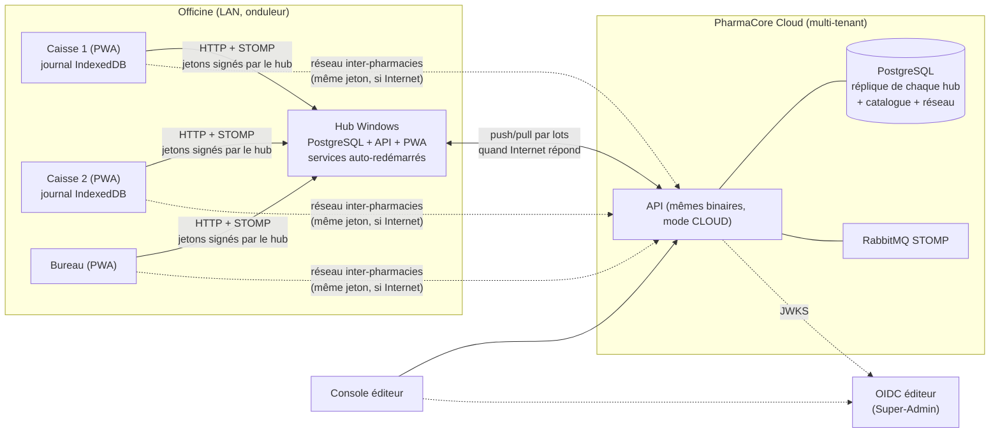
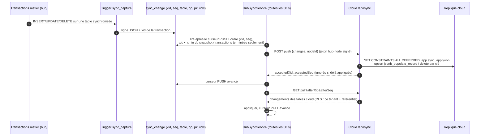
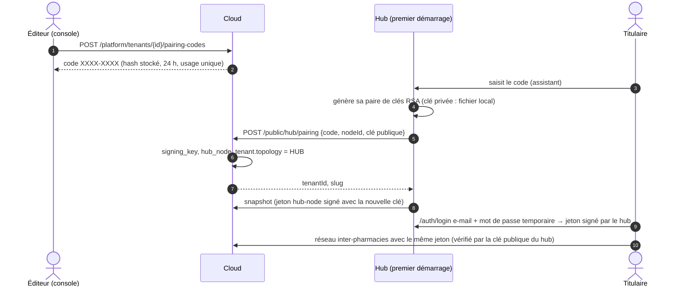

# PharmaCore PGO — Architecture technique (v2 : hub local + cloud)

Progiciel de Gestion d'Officine pour le marché ouest-africain : caisse et gestion entièrement
utilisables sans Internet sur plusieurs postes Windows, réseau inter-officines, comptabilité
SYSCOHADA, console éditeur. Le périmètre fonctionnel comparé au marché est dans
[FEATURES.md](FEATURES.md), l'installation et la résilience dans [WINDOWS.md](WINDOWS.md), le
système de design dans [UX.md](UX.md).

| Couche | Choix |
|---|---|
| Backend | Java 26, Spring Boot 4.1.1 (MVC + threads virtuels), Spring Security 7, Hibernate 7, Flyway. **Un seul binaire, deux rôles** (`pharmacore.node.mode = HUB | CLOUD`) |
| Base | PostgreSQL 17 : `tenant_id` + Row-Level Security ; journal de changements par trigger pour la synchronisation |
| Temps réel | WebSocket STOMP (local sur le hub ; relais RabbitMQ sur le cloud) |
| Frontend | Angular 22 (standalone, signals, zoneless), Tailwind 4, PWA installable, IndexedDB (Dexie) |
| Poste Windows | Services Windows (WinSW) : PostgreSQL portable + hub ; PWA servie par le hub |

---

## 1. Topologie : pourquoi un hub local

Au Niger, Internet est intermittent et le courant coupe. Un PGO qui dépend du cloud s'arrête
avec la connexion ; un PGO purement mono-poste ne partage pas le stock entre les caisses. Le
compromis retenu est un **serveur local par officine (hub)**, maître de ses données
opérationnelles, qui réplique vers le cloud quand il le peut.

Trois modes d'exploitation coexistent avec le même code :

| Mode | Qui est maître des ventes/stocks | Hors-ligne | Cas d'usage |
|---|---|---|---|
| **Hub** (`tenant.topology = HUB`) | Le hub de l'officine | Total, multi-postes, durée illimitée | Officines nigériennes : cible principale |
| **Cloud direct** (`topology = CLOUD`) | Le cloud | Par poste (journal IndexedDB), pas de stock partagé hors-ligne | Petite officine bien connectée, démonstrations |
| **Console** | — | — | Éditeur : supervision, catalogue, appairage |

Sur le cloud, un filtre (`TopologyGuardFilter`) refuse toute écriture opérationnelle pour une
pharmacie en mode hub : il ne peut y avoir qu'un maître.

---

## 2. Synchronisation hub ↔ cloud

### 2.1 Propriété des données : zéro conflit

Chaque table a **un seul propriétaire**. Le propriétaire écrit, l'autre côté reçoit une
réplique en lecture. Il n'y a donc jamais deux écritures concurrentes sur une même ligne, et
aucune résolution de conflit à inventer.

| Propriétaire | Tables |
|---|---|
| **Cloud** | `product` (catalogue national), `tenant` (abonnement), `subscription_plan`, `subscription_payment`, `tenant_license`, `pharmacy_network`, `network_membership`, `inter_pharmacy_transfer`, `guard_schedule`, `conversation`, `chat_message` |
| **Hub** | tout le reste : configuration, utilisateurs et rôles, stocks et lots, ventes, caisse, clients, fournisseurs, commandes, réceptions, comptabilité, clés de signature |
| **Les deux, par origine** | `audit_event` : chaque côté chaîne ses propres événements (`origin = HUB|CLOUD`) et pousse les siens |

Les fonctions réseau (réservations, gardes, messagerie) exigent Internet par nature : la PWA
les appelle directement sur le cloud avec le jeton émis par le hub (le cloud connaît la clé
publique du hub). Hors-ligne, le hub en garde une copie consultable.

### 2.2 Journal de changements et lecture sûre

Points qui rendent le protocole sûr :

* **Ordre (xid, seq) + horizon xmin** : une transaction qui valide « en retard » a toujours un
  xid supérieur au curseur, elle sera lue au tour suivant. Aucun changement sauté.
* **Clés étrangères différables** : un lot est vérifié à sa validation ; si un lot est coupé au
  milieu d'une dépendance, le cloud répond 409 et le hub renvoie un lot deux fois plus grand.
* **Idempotence** : le cloud mémorise la dernière position acceptée par hub ; un lot renvoyé
  après une réponse perdue est ignoré. Les upserts sont par clé primaire.
* **Pas d'écho** : l'application d'une réplique positionne `app.sync_apply = on`, le trigger ne
  recapture pas ; le drapeau est relâché avant l'événement d'audit `SYNC_PUSH_APPLIED` que le
  cloud écrit pour chaque lot accepté, visible du hub au tour suivant.
* **Tables en écriture seule** (audit, mouvements de stock, journal comptable) : rejouées en
  insertion pure, une ligne déjà présente est la même ligne ; aucune mise à jour ni suppression.
* **Amorçage et reprise** : à l'appairage (ou après une coupure plus longue que la rétention du
  journal, détectée par le filigrane de purge), le hub charge un **instantané** table par table
  puis reprend le journal à partir de la position notée au début de l'instantané.
* **Générique** : aucune ligne de code par table ; les colonnes et clés primaires sont lues
  dans le catalogue PostgreSQL. Ajouter une table synchronisée = une ligne dans `sync_table`.
* **RLS maintenue** : le cloud applique les lots sous l'identité du hub (`Actor.HubNode`,
  borné à son tenant) ; une ligne d'une autre pharmacie est rejetée par la base.

### 2.3 Appairage et identités

* **Aucun secret partagé** : chaque nœud signe ses jetons (RS256) ; le cloud publie la sienne,
  les hubs publient la leur à l'appairage. `InternalIssuerRegistry` résout `(issuer, kid)` dans
  `signing_key`.
* **Authentification hors-ligne** : comptes locaux (bcrypt), mot de passe pour ouvrir un poste
  (30 jours), **PIN** pour basculer de caissier, verrouillage 15 min après 5 échecs, jetons
  d'accès 15 min + rafraîchissement 14 h avec rotation. Les échecs sont journalisés dans l'audit
  (transaction séparée, donc conservés même si la tentative est rejetée).
* **Abonnement** : le hub applique la licence signée par le cloud, sans réseau (voir §4.4).

---

## 3. Isolation multi-tenant (inchangée, renforcée)

Colonne `tenant_id` + Row-Level Security PostgreSQL sur toutes les tables métier, contexte porté
par `ScopedValue<RequestContext>` et lié à la connexion (`set_config('app.tenant_id')`) ; le
pool fait `SET ROLE pharmacore_app`. Sans contexte, aucune ligne n'est visible. Les fonctions
inter-pharmacies (`network_stock_availability`, `network_directory`) sont des `SECURITY DEFINER`
possédées par un rôle aux droits colonne par colonne : aucun prix, coût, lot ou vente ne
franchit la frontière d'une pharmacie. Sur un hub, la base ne contient qu'un tenant mais les
mêmes politiques s'appliquent (défense en profondeur si une base est consolidée un jour).

---

## 4. Domaines métier ajoutés en v2

| Domaine | Composants | Règles clés |
|---|---|---|
| **Caisse africaine** | `PaymentMethod.MOBILE_MONEY` (+ opérateur), `CREDIT` ; `CustomerService`, `CashSessionService` | Crédit plafonné par client (verrou pessimiste), anomalies `CREDIT_NOT_ALLOWED` / `CREDIT_LIMIT_EXCEEDED` (refus en ligne, revue hors-ligne) ; session de caisse par poste (fond, mouvements, dépenses, Z, écart passé en 658/758) |
| **Facture certifiée** | `CertifiedInvoicePort` (port), `CertificationService` (file et relances), statut par vente | La vente est locale d'abord ; la certification SECeF est asynchrone et rejouée ; le connecteur DGI est un adaptateur à brancher |
| **Approvisionnement** | `OrderProposalCalculator` (domaine pur), `ProcurementService` | Cible = demande journalière × (délai + couverture + sécurité) ; demande = ventes + ventes perdues (écarts hors-ligne) ; − disponible + en commande ; remplace les lots qui périment ; arrondi au colisage ; seuils du pharmacien prioritaires |
| **Comptabilité** | `EntryDraft` (partie double garantie à la construction et par trigger différé), `AccountingPoster`, `Postings`, `AccountingReportService` | Écritures dans la même transaction que l'opération ; numérotation sans trou ; périodes clôturables ; contre-passation (jamais de modification) ; résultat = ventes − (achats + stock initial − stock final) − charges ; bilan simplifié avec stock au coût moyen pondéré |
| **Identité locale** | `LocalAuthService`, `AuthSessionStore`, `SigningKeyService` | Voir §2.3 |
| **Nœud** | `NodeIdentity`, `NodeSettings`, `HubSyncService`, `CloudSyncService`, `PairingService` | Voir §2 |

Le modèle de données complet est dans les migrations `V1`…`V7` (`backend/src/main/resources/db/migration`).

### 4.1 Domaines ajoutés en v3

| Domaine | Composants | Règles clés |
|---|---|---|
| **Annuaire public** (cloud) | fonctions `SECURITY DEFINER` `public_pharmacies`, `public_availability`, `partner_stock_availability`, `public_guards` ; `PublicDirectoryController`, `PublicRateLimiter` | Opt-in par officine (`public_listing`, `public_availability`) et par réseau (`publish_guards`) ; le public ne voit qu'un **niveau** (disponible / dernières unités), jamais de quantité, de prix ni de lot ; limitation à 30 requêtes par minute et par adresse ; usage audité en compteurs agrégés ; texte de partage WhatsApp/SMS généré par `GuardShareText` (domaine pur) |
| **Recherche réseau** | `GET /api/v1/network/stock?q=`, `GET /api/v1/network/pharmacies/{id}/stock?q=` | « Qui a ce produit ? » sur plusieurs produits à la fois et « qu'a cette pharmacie ? », toujours plafonnés par `quantity_cap` du réseau |
| **Fiabilité du stock** | `StockCountService`, `StockIntegrityService`, `ExpiryWriteOffService`, `InventoryJobs` | Inventaire **à l'aveugle** (attendu figé au démarrage, masqué au compteur, écart appliqué à la validation par mouvement `COUNT_ADJUSTMENT`) ; contrôle nocturne recalculant chaque lot depuis ses mouvements et les réservations depuis le journal (écarts audités `STOCK_INTEGRITY_MISMATCH`) ; sortie automatique des lots périmés (`EXPIRY_WRITE_OFF`, valeur au coût) ; lecture GS1 DataMatrix (lot, péremption) au comptoir, à la réception et à l'inventaire |
| **Fiabilité de la caisse** | `CashSessionService`, `CashReportHashing`, `Denominations`, `SupervisorApprovalService`, `PaymentReconciliationService` | Clôture par **coupures XOF** et montants déclarés par mode et opérateur, rapprochement avec les paiements enregistrés, attendu masqué au caissier (clôture à l'aveugle) ; écart au-delà du seuil → approbation `CASH_APPROVE` ; rapports Z **chaînés par SHA-256** par poste ; annulation au-dessus d'un seuil ou sur session fermée → PIN d'un superviseur ; paiements mobile money et carte en attente de confirmation sur relevé opérateur, référence de transaction **unique** (index + anomalie `DUPLICATE_PAYMENT_REFERENCE`) |
| **Tiers payant** | `InsurerService`, `InsuranceCoverageResolver`, `InsuranceStatementService`, `CoverageContext` (règle pure) | Part assureur = arrondi de net × taux de la police, plafonnée par le plafond mensuel restant ; déclarée différente → `INSURANCE_SHARE_MISMATCH` ; police invalide ou d'un autre client → `INSURANCE_POLICY_INVALID` ; créance au sous-compte `4112nnn` de l'assureur ; bordereaux `BRD-AAAA-NNNN` (génération verrouillée, émission, CSV, règlement partiel ou total par virement/chèque/carte/mobile money, jamais en espèces) ; encours par assureur |
| **Ordonnances** | `PrescriptionService`, `DispensingRegisterService` | Registre des délivrances sur ordonnance (listes I, II, stupéfiants) avec export audité ; ordonnances renouvelables (délivrances autorisées, dernière délivrance, expiration), refus `PRESCRIPTION_RENEWAL_REFUSED`, rappels dus |
| **Pilotage** | `DashboardService` | Une requête d'agrégat par indicateur ; marge brute = net − coût des lots alloués ; comparaison avec la période précédente de même longueur ; période bornée à un an |
| **Substitution** | `CatalogService.alternatives`, `CatalogSyncService.alternatives` (poste) | Même DCI et même dosage ; disponibilité et prix de l'officine ; calculée hors ligne sur le cache IndexedDB du poste |

Migrations `V8`…`V11`. Les tables de v3 suivent `docs/CONVENTIONS.md` : RLS, droits, enregistrement
dans `sync_table`, clés étrangères différables.

### 4.2 Domaines ajoutés en v4

| Domaine | Composants | Règles clés |
|---|---|---|
| **Importation de données** | `TabularReaders` (`CsvReader`, `XlsxReader` SpreadsheetML sans dépendance), `ColumnMapping`, `ValueParsers`, `RowLoaders`, `CatalogWriter`, `ImportService`, table `import_job` | Détection du format par le contenu, du jeu de caractères (UTF-8, BOM, Windows-1252) et du séparateur ; en-têtes reconnus par alias normalisés (accents, ponctuation) puis corrigés par l'utilisateur ; aperçu qui exécute chaque ligne et l'annule ; une transaction **par ligne** (une ligne fautive n'annule pas les autres), essai à blanc par rollback ; montants, pourcentages et dates tolérants (« 1 250 », « 09/2027 », numéro de série Excel) ; produit sans code → code interne stable préfixe 200 (GS1 restreint) ; les produits inconnus d'une officine sont créés dans le référentiel par un **processus plateforme en transaction séparée** (la politique RLS réserve l'écriture du catalogue à la plateforme) ; créances clients reprises comme solde d'ouverture audité ; journal `import_job` répliqué vers le cloud |
| **Impression** | `ReceiptDocument`, `ReceiptLayout`, `EscPosRenderer`, `TextReceiptRenderer`, `PrinterPort` (`NetworkPrinter`, `SharedPrinter`), `PrintSettingsService`, `ReceiptPrintService`, table `terminal_printer` | Réglage par poste (mode navigateur, ESC/POS réseau 9100 ou partage Windows ; papier 58 mm / 80 mm / A4 ; exemplaires, coupe, tiroir, impression automatique) ; rendu ESC/POS en 32 ou 48 colonnes, CP858 avec repli ASCII, QR de certification ; un ticket non encore synchronisé s'imprime depuis le panier (`POST /api/v1/print/tickets`), repli sur l'impression navigateur si l'imprimante ne répond pas ; facture A4 avec montant en lettres ; audit `RECEIPT_PRINTED` |

Migrations `V12` et `V13`.

### 4.3 Emplacements de rangement

| Domaine | Composants | Règles clés |
|---|---|---|
| **Emplacements** | `StorageLocationService`, `LocationCode`, `Placement`, `StorageLocationKind` (domaine pur), table `storage_location`, colonnes `stock.location_id` / `location_detail` | Code court unique par pharmacie, normalisé (majuscules sans accents, 16 caractères) ; détail libre (« case 12 ») oublié quand le produit change d'emplacement ; désactivation refusée tant que des produits y sont rangés, sauf réaffectation dans la même opération (verrous : partagé à l'affectation, exclusif à la désactivation) ; renommer un emplacement réémet ses produits vers le cache hors ligne des caisses (`updated_at` dans le curseur du flux POS) ; inventaire limité à un emplacement ; import d'un emplacement en texte libre rattaché au code existant ou créé. L'ancien texte libre `stock.location` est repris par `V14` avec des identifiants déterministes (mêmes lignes sur le hub et le cloud) |

Migration `V14`.

### 4.4 Abonnements et licence hors ligne

L'éditeur encaisse les abonnements hors de l'application (mobile money, virement, espèces,
chèque) et les enregistre dans la console (`/platform/subscriptions`). Le blocage d'une pharmacie
doit tenir même si son serveur local ne revient jamais en ligne : le hub applique une **licence
signée par le cloud**, qu'il vérifie seul.

| Élément | Composants | Règles clés |
|---|---|---|
| **Formules et règlements** | `subscription_plan` (référentiel, prix mensuel en francs CFA, postes), `subscription_payment` (écriture seule), `PlatformSubscriptionService` | Un règlement prolonge `tenant.subscription_expires_at` (= payé jusqu'au) à partir de sa fin, ou d'aujourd'hui si elle est passée (`SubscriptionPeriod`, mois calendaires dans le fuseau de la pharmacie) ; changement de formule ; suspension motivée et datée (`tenant.suspended_at`) puis réactivation ; chaque action est auditée et réémet la licence |
| **Licence** | `LicenseCodec`, `LicenseKeys` (domaine pur), `LicenseKeyRing`, `LicenseIssuer`, table `tenant_license` | Jeton compact `PCL1.<kid>.<revendications>.<signature>` signé en **Ed25519** par une clé dédiée du cloud (fichier `license-<kid>.p8` du dossier des clés, clé publique dans `license_key`) ; revendications : pharmacie, identifiant, formule, postes, statut, payé jusqu'au, fin de grâce, date de suspension, émission, **validité = émission + 15 jours**, **numéro de série croissant** ; réémise à chaque règlement, changement de formule, suspension ou réactivation, et dès qu'elle a plus d'une heure quand un hub la demande |
| **Épinglage et rafraîchissement** | `PairingService` (réponse d'appairage), `HubLicenseService`, `HubLicenseSync`, `POST /api/sync/license`, `GET /api/sync/license-keys` | À l'appairage (HTTPS, confiance au premier appairage) le hub épingle les clés publiques de licence et reçoit sa première licence ; à chaque cycle de synchronisation (et sur `POST /api/v1/subscription/refresh`) il demande une licence fraîche : la fenêtre de 15 jours glisse tant qu'il est en ligne et à jour. Une nouvelle clé (rotation : `POST /api/platform/subscriptions/license-keys/rotation`) n'est épinglée que si une clé déjà épinglée l'**endosse** : un faux cloud ne peut pas imposer la sienne. Un hub appairé avant les licences épingle la première liste reçue et dispose d'une fenêtre de 15 jours pour la recevoir |
| **Anti-fraude du hub** | `HubLicenseRules` (domaine pur) | Signature vérifiée avec une clé épinglée, pharmacie du hub, jamais de numéro de série inférieur à celui détenu ; **filigrane d'horloge** persistant (plus grande heure vue) : un retour en arrière de plus de 10 minutes bloque (« horloge du poste incohérente ») ; une licence fraîche réancre le filigrane quand l'horloge locale concorde avec celle du cloud (sortie d'erreur après correction de l'heure) |
| **État et application** | `LicenseEvaluator` (domaine pur), `LicenseStateService`, `LicenseEnforcementFilter`, `BlockedRequestPolicy` | États `ACTIVE`, `WARNING` (fin de période payée à J-7, fenêtre hors ligne à J-5), `GRACE` (3 jours après la période payée : « Abonnement expiré — régularisez avant le … »), `BLOCKED` (`SUSPENDED`, `EXPIRED`, `OFFLINE_TOO_LONG`, `CLOCK_TAMPERED`, `NO_LICENSE`). Cloud : calculé depuis sa base (cache 30 s vidé à chaque événement, donc immédiat) ; hub : depuis la licence détenue et le filigrane. Bloqué : toute modification d'un membre de la pharmacie reçoit **423** et un problème en français ; restent ouverts la lecture (registres, ordonnancier, rapports, exports), la connexion, le mot de passe et le PIN, la synchronisation, le rafraîchissement de licence, le signal de vie des postes et la réimpression. L'opérateur éditeur, les hubs et les processus système ne sont jamais bloqués |
| **Ventes hors ligne rejouées** | `SaleSyncService` | **Décision** : une vente faite sur un poste hors ligne **avant** le blocage (`occurredAt` antérieur à la suspension, à la fin de grâce ou à la limite hors ligne) est enregistrée : la marchandise est sortie et l'argent encaissé quand la pharmacie en avait le droit. Une vente postérieure, ou toute vente quand le blocage n'est pas datable (horloge, absence de licence), reçoit `RETRY` : elle reste dans le journal du poste et passe à la régularisation, jamais perdue, jamais enregistrée pendant le blocage |
| **Postes** | `LicenseStateService` (PWA), `license.ts`, bandeau du shell, caisse | L'état est interrogé toutes les 5 minutes et mis en cache par pharmacie ; hors ligne, le poste fait avancer l'état avec son horloge (avertissement, grâce, blocage aux dates annoncées, état de plus de 15 jours = blocage) et la caisse refuse de valider une vente bloquée |

Limites assumées : la protection est logicielle. Un binaire modifié, ou un administrateur de la
base du hub qui remplace la clé épinglée, le jeton et le filigrane dans `node_setting`, contourne
le blocage ; l'horloge d'un poste PWA isolé de son serveur n'est contrôlée que par rapport à sa
dernière réponse. Le cloud multi-instances applique une suspension au plus 30 s plus tard sur les
autres instances (cache local). La clé privée de licence est un secret du cloud : la perdre impose
de réappairer les hubs (aucune nouvelle clé ne peut plus être endossée).

Migration `V15`, permission `SUBSCRIPTION_VIEW` (titulaire).

---

## 5. Frontend : local-first sur chaque poste

* **Nœud** : au démarrage la PWA lit `/api/public/hub/info` : mode, pharmacie, URL du cloud. En
  mode hub, l'API est l'origine de la page (le hub sert la PWA) ; les fonctions réseau pointent
  vers le cloud.
* **Ventes** : chaque vente est validée dans IndexedDB (journal + décrément de stock dans une
  seule transaction Dexie), le ticket est imprimé, puis le journal est rejoué vers le hub
  (lots, Web Locks, backoff, réponses `ACCEPTED/DUPLICATE/REJECTED/RETRY`). Si le hub tombe, le
  poste continue sur son catalogue en cache.
* **Catalogue et prix** : pull incrémental par curseur.
* **Écrans v2** : connexion mot de passe / PIN, assistant d'appairage, état du serveur local,
  sessions de caisse (X/Z, dépenses), clients et créances, fiche de commande et commandes,
  comptabilité (résultat, bilan, balance, export), préférences d'affichage par poste.
* **Devise** : `CurrencyService` + `MoneyPipe` : XOF affiché sans décimales, saisie libre.

---

## 6. Exploitation

| Variable / propriété | Rôle |
|---|---|
| `PHARMACORE_MODE` (`pharmacore.node.mode`) | `HUB` ou `CLOUD` |
| `PHARMACORE_KEYS_DIR` | Dossier de la clé privée de signature |
| `PHARMACORE_CLOUD_URL` | Cloud joint par le hub |
| `pharmacore.node.sync-interval` | Cadence de synchronisation (et de rafraîchissement de la licence) |
| `pharmacore.subscription.*` (`PHARMACORE_VENDOR_NAME`, `_EMAIL`, `_PHONE`) | Contact de l'éditeur affiché aux pharmacies ; délais (avertissement 7 j, grâce 3 j, fenêtre hors ligne 15 j, avertissement 5 j, tolérance d'horloge 10 min) |
| `INVOICE_CERTIFICATION` | `NONE` (défaut) ou le nom de l'adaptateur de certification |
| `DB_*`, `OIDC_PLATFORM_ISSUER`, `ALLOWED_ORIGINS` | Voir v1 |

Profil Spring `hub` (`application-hub.yml`) : PostgreSQL local sur 5433, journaux dans le
dossier de données, aucun émetteur OIDC. Paquet Windows : `packaging/windows/` et workflow
`Hub Windows package` (`.github/workflows/windows-hub.yml`).

Logs JSON (ECS) avec `correlation_id`, `tenant_id`, `actor`. Sondes `/actuator/health`.

---

## 7. Décisions et limites

* **Hub = même binaire que le cloud.** Moins de code, un seul modèle de données, tests communs ;
  le mode ne change que l'émetteur de jetons, le sens de synchronisation et quelques gardes.
* **Propriété stricte plutôt que CRDT / fusion.** Simplicité et auditabilité ; la contrepartie
  est qu'une pharmacie en mode hub ne peut pas vendre depuis le cloud, ce qui est le but.
* **Synchronisation à l'intervalle, pas à l'événement.** 30 s suffisent pour la supervision et
  le réseau ; cela évite une connexion persistante coûteuse en 4G.
* **PostgreSQL complet sur le hub** (pas d'embarqué type H2/SQLite) : mêmes migrations, RLS,
  durabilité (`fsync`, `full_page_writes`), sauvegardes `pg_dump`.
* **Authentification locale** plutôt qu'un IdP local : rien à administrer en officine ; le
  realm OIDC reste réservé à l'éditeur (et optionnel pour des groupes qui fédèrent).
* **Limite de requêtes réseau** en mémoire par nœud ; **Background Sync** Chromium seulement ;
  **hébergement** des données de santé à conformer à la réglementation locale.
* **Non livré** (voir FEATURES.md) : connecteur SECeF (spécifications DGI nécessaires),
  bordereaux tiers payant, tableaux de bord graphiques, inventaire guidé, pilotage direct du
  tiroir-caisse et de l'imprimante ESC/POS (coque Tauri prévue).
